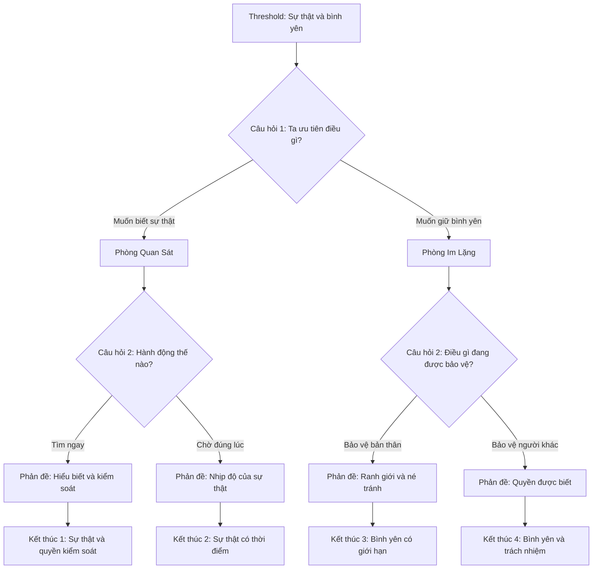

# HIYU ABYSS — WEBSITE EXPERIENCE MASTERPLAN V3.0

**Trạng thái:** Đặc tả đề xuất để chủ dự án duyệt; **chưa phải website đã triển khai**.  
**Ngày:** 2026-11-15  
**Repository:** `https://github.com/minhhuyzzz/hiyu-abyss`  
**Website hiện tại:** `https://hiyuabyss.vercel.app/`  
**Áp dụng:** nâng cấp toàn bộ `website/` và hệ thống nội dung/ảnh liên quan; giữ nguyên tinh thần HYA-01 → HYA-07.  
**Mục tiêu chi phí:** static-first, không database, không bắt buộc API trả phí, không yêu cầu login.

> **Tuyên ngôn sản phẩm:** Hiyu Abyss là một thư viện tư tưởng, một ấn phẩm mỹ thuật sống và một không gian phản tư tương tác; nội dung mở về mọi lĩnh vực đáng suy ngẫm. Tối giản về sự nhiễu loạn, không tối giản về trải nghiệm.

---

## 0. KẾT LUẬN ĐÁNH GIÁ HIỆN TRẠNG — CÁI GÌ PHẢI THAY ĐỔI

Đối chiếu mã nguồn nhánh `main` ngày 2026-11-15:

- `website/src/pages/index.astro` chỉ gọi `HeroArtwork`, `EditorialMosaic` và section tuyên ngôn. Cần thiết kế lại cấu trúc và nhịp điệu trang chủ.
- `HeroArtwork.astro`, `EditorialMosaic.astro`, `QuoteCard.astro`, `Header.astro` dùng dày đặc rounded-pill, double-bezel, glass, shadows, card/bento. Thay **ngôn ngữ giao diện** theo hướng editorial + museum, không chỉ đổi màu.
- `/library` và `/themes/[slug]` cùng dùng lưới `QuoteCard` đồng dạng. Thiếu chế độ duyệt, lọc nhiều chiều, sự phân cấp mỹ thuật và liên kết tư tưởng.
- `MirrorJourney.tsx`: trạng thái `INTRO → QUESTION → REFLECTION → COUNTERPOINT → OPEN_ENDING`; lựa chọn chỉ ảnh hưởng phần Reflection. Phải chuyển thành **đồ thị cảnh** với nhiều lựa chọn tiếp nối, cảnh phân nhánh và kết thúc riêng.
- `MIR-0001.yaml` là hành trình tuyến tính; thiết kế schema V3 cần có `nodes`, `choices`, `to`, `endings`, `scene`, `motion` và validation.
- `search.astro` đang nhúng search index và lọc phía client thủ công; chưa dùng Pagefind. Chuyển dần sang Pagefind có chỉ mục build-time, không đánh đổi khả năng tìm tiếng Việt.
- `publication-manifest.yaml` liệt kê 100 ID; `content-publisher.ts` kiểm trạng thái APPROVED/PUBLISHED: giữ gate, nhưng chấp nhận **số lượng bài đã duyệt động** thay vì hard-code 100.
- `asset-catalog.json` có tên tranh/hoạ sĩ/giấy phép ở dạng nhãn, chưa đủ URL nguồn, ID bảo tàng và bằng chứng quyền sử dụng cho từng file. Cần metadata chứng minh được.
- `astro.config.mjs` để `site: https://hiyuabyss.com` trong khi Vercel URL đang sử dụng khác; cần biến môi trường/canonical thống nhất.
- Chưa có `/about`, `/thinkers`, `/works`, `/essays`, `/artworks` trong routes hiện hữu. Những trang mới chỉ nên hiển thị khi có nội dung được phê duyệt, không tạo trang rỗng hàng loạt.

**Định nghĩa “chuyên nghiệp”:** Có ngôn ngữ mỹ thuật nhất quán; mỗi loại nội dung có bố cục phù hợp; phân cấp thông tin rõ; tương tác có ý nghĩa; dữ liệu có xuất xứ; nhanh và dễ tiếp cận trên điện thoại; các lời khẳng định có thể kiểm chứng. Không đồng nghĩa với thêm nhiều animation hoặc thật nhiều section vô nghĩa.

## 1. NHÓM NGƯỜI ĐỌC, NHIỆM VỤ VÀ CÁC TUYẾN TRẢI NGHIỆM

### 1.1 Ba nhóm hành vi

1. **Người đến từ TikTok**: ấn vào link, muốn thấy ngay một tuyên ngôn/triết ngôn có sức nặng, lưu/chia sẻ, rồi tự khám phá.
2. **Người yêu văn học/tư tưởng/nghệ thuật**: tìm theo khái niệm, tác giả, tác phẩm, bản dịch, nguồn tranh, và các luận điểm liên quan.
3. **Người muốn tự phản tư**: chọn một chủ đề, bước vào một câu chuyện nhiều nhánh; được tự do quay lại, không bị chấm điểm hay gắn nhãn.

### 1.2 Bốn user journeys chính

- **TikTok → trang tác phẩm → luận giải → nguồn → bài liên quan → lưu/chia sẻ.**
- **Trang chủ → Gallery of Thought → chủ đề → Library → bài đọc sâu → Thinker/Work.**
- **Trang chủ → The Mirror → chọn các nhánh → nhận phản đề riêng → kết thúc mở → nội dung tham khảo.**
- **Search → kết quả liên hợp (triết ngôn, chủ đề, tác giả, tác phẩm, bài luận) → đọc → tiếp tục khám phá.**

### 1.3 Bản đồ thông tin mục tiêu

```text
/                       The Entrance — 12 phân cảnh landing
/library                The Library — browse / editorial / gallery / index
/library/[slug]         Trang đọc có artwork, luận giải, nguồn, nội dung liên quan
/themes                 Atlas chủ đề mở
/themes/[slug]          Chuyên đề tổng quan + các tác phẩm/ý tưởng liên quan
/mirror                 Portal của The Mirror + danh mục hành trình
/mirror/[journey]       Scene-based branching experience (React island)
/thinkers               Danh mục tư tưởng gia
/thinkers/[slug]        Hồ sơ tư tưởng gia, tư tưởng chính, tác phẩm
/works                  Danh mục sách/tác phẩm
/works/[slug]           Trang nguồn/tác phẩm và các luận điểm liên quan
/essays                 Tạp chí bài luận dài
/essays/[slug]          Bài luận có mục lục và trích dẫn
/artworks               Phòng trưng bày hình ảnh được cấp quyền
/artworks/[slug]        Chi tiết tác phẩm mỹ thuật + provenance
/search                 Tra cứu toàn trang
/about                  Tuyên ngôn, quy trình biên tập, nguồn, liên hệ
/404                    Trang lỗi được thiết kế riêng
```

**Phased publishing:** trang mới chỉ xuất hiện sau khi có dữ liệu và QC; không để link 404 trong nav. Trước mắt nav cấp 1: Library / Mirror / Explore / Search; Explore là menu thứ cấp cho Themes, Thinkers, Works, Essays, Artworks; About ở footer.

## 2. THIẾT KẾ THỊ GIÁC — MUSEUM EDITORIAL, KHÔNG DASHBOARD / AI TEMPLATE

### 2.1 Creative direction

- **Dark / Black Archive**: mực đen `#090A09`, surface `#131513`, chữ giấy ngà `#EAE5DA`, pigment đồng `#C29A77`, đỏ oxit `#B47862`, patina `#96A79A`.
- **Light / Pale Archive**: giấy khoáng `#ECE9E1`, surface `#F5F2EB`, chữ mực `#24251F`, điểm nhấn `#76513D`, oxit `#8A4D43`, patina `#536C60`.
- Không thêm màu tím neon, cyan, các gradient tổng hợp hay xanh công nghệ. Chỉ dùng tông sắc tố có lý do nghệ thuật.
- Dark/Light **không chỉ đảo token**: xử lý độ sáng tác phẩm, lớp phủ ảnh, viền chú thích, shadow, kiểu phân cách, các nguồn sáng và nhịp đọc riêng; tuyệt đối không biến light thành vàng be bẩn, khó đọc.
- **Typographic roles**: Cormorant Garamond (display, tên chương); Literata (triết ngôn & bài đọc); Be Vietnam Pro (UI, metadata). Lưu ý thử chữ Việt ở tất cả weight và italic; chỉ tải weights cần dùng.

### 2.2 Bố cục và nguyên tắc chống đại trà

- Dùng **editorial grid 12 cột** trên desktop, 6 cột tablet, 4 cột mobile, content max-width 1440px, prose 65–75ch.
- Dùng 5 nhịp thị giác: *full bleed* (tranh toàn bề ngang), *split editorial* (tranh + chữ bất cân xứng), *quiet typography* (chữ và khoảng trống), *museum wall* (gallery), *footnote archive* (nguồn & metadata).
- Mỗi viewport không quá 1 điểm nhấn chuyển động mạnh; **không phải mọi thứ đều là card**.
- Giới hạn rounded radius ở control nhỏ, loại bỏ double-bezel đại trà; tác phẩm có thể dùng đường viền mảnh hoặc mép giấy thay vì mô phỏng card SaaS.
- Tạo `SectionIndex`/số mục nhỏ có tính hệ thống; metadata trở thành một phần mỹ thuật, không được lạm dụng badge.
- Có khoảng trống, tương phản kích thước và những khoảnh khắc bất đối xứng. Không chạy tất cả section cùng mẫu `h2 + grid(3) + CTA`.

### 2.3 Design tokens cần có

`--color-bg`, `--color-paper`, `--color-ink`, `--color-muted`, `--color-rule`, `--color-accent`, `--color-oxide`, `--color-patina`, `--font-display`, `--font-reading`, `--font-ui`, `--space-section`, `--measure-prose`, `--duration-fast`, `--duration-medium`, `--duration-slow`, `--ease-editorial`.

Responsive: 320, 375, 430, 768, 1024, 1440, 1920px. Dark & Light ở tất cả breakpoints. Bàn phím, focus, screen reader và `prefers-reduced-motion` là tiêu chí bắt buộc.

## 3. LANDING V3 — 12 PHÂN CẢNH CÓ ĐỘ SÂU

Trang chủ không phải quảng cáo tính năng. Nó kể câu chuyện từ sự gặp gỡ → tò mò → khám phá → đối thoại → trở lại.

| # | Section | Mục tiêu / thành phần | Bố cục & hình ảnh | Chuyển động có chủ đích |
|---|---|---|---|---|
| 01 | **Entrance / Opening Seal** | Logo, ngôn từ ngắn nhận diện, vào Library / Mirror | Full-bleed nghệ phẩm với lớp chữ gọn; không navbar hình viên thuốc che tranh | Lớp tranh xuất hiện theo độ sâu rất nhẹ; không autoplay video nặng |
| 02 | **Inscription of the Day** | Một câu trọng tâm và nguồn | Ấn phẩm chữ lớn, khoảng trống, có số lưu trữ | Text reveal theo **khối câu**, không từng chữ có thể gây khó đọc |
| 03 | **Curator's Selection** | 3–5 tác phẩm được biên tập | Editorial asymmetric wall, tỉ lệ ảnh 3:4, 4:5, 16:9 luân phiên | Reveal khi vào viewport, nhẹ và một lần |
| 04 | **The Library Threshold** | Lý do vào thư viện, cách khám phá | Split full-height: vật thể/ảnh + văn bản và link | Transition khi chuyển sang Library nếu trình duyệt hỗ trợ |
| 05 | **Atlas of Ideas** | Mở hệ chủ đề, không khóa 20 topic | Typographic atlas với tác phẩm tiêu biểu; không list chip là chính | Hover/focus làm nổi một tranh theo chủ đề, không cần WebGL |
| 06 | **One Work / Many Interpretations** | Chứng tỏ chiều sâu học thuật | Tác phẩm lớn + các góc đọc: chi tiết tranh, câu chữ, nguồn, phản đề | Đổi panel với fade/crossfade 220–350ms |
| 07 | **The Mirror Portal** | Dẫn đến trải nghiệm nhiều nhánh | Ẩn dụ tấm gương/khung tranh nhiều lớp, CTA rõ | Parallax 2D rất nhẹ (chỉ pointer fine, desktop); trên mobile static |
| 08 | **The Long Read** | 1 bài luận có hình nổi bật | Editorial spread; excerpt + reading time + nguồn | Transition trên ảnh, không zoom liên tục |
| 09 | **Thinkers & Works** | Giới thiệu tư tưởng gia và sách | Vertical filmstrip, chân dung/ảnh bìa nguồn hợp lệ | Điều hướng ngang có nút, keyboard, snap |
| 10 | **Artworks in Dialogue** | Gallery tranh và mối quan hệ với tư tưởng | Museum gallery với caption, niên đại, người giữ bản gốc | Hover reveal thông tin, focus/keyboard tương đương |
| 11 | **A Question to Carry** | Câu hỏi phản tư ngắn, mở lối The Mirror | Full-width quiet typography, nền khác nhịp | Text fade nhẹ; không bắt buộc trả lời |
| 12 | **Closing / Invitation** | Tuyên ngôn, nguồn biên tập, follow TikTok, khám phá tiếp | Nền tĩnh, khoảng trống, chữ sâu, footer đã cải tiến | Không animation, tạo điểm nghỉ |

### 3.1 Quy tắc triển khai landing

- Mỗi section có **content contract**: nếu thiếu dữ liệu được duyệt, section có fallback biên tập được hoặc ẩn hợp lệ, không để tác phẩm giả.
- Header không chiếm tầm nhìn; có sticky compact sau khi scroll, link chính dễ tìm; mobile menu rõ ràng.
- Không gắn một tác phẩm bất kỳ chỉ vì hợp tông đen; cần quan hệ tư tưởng/chủ đề, caption trung thực.
- Các lời kêu gọi thao tác phân bổ hữu ích: Vào Library, xem tuyển tập, trải nghiệm Mirror, khám phá tác giả/tác phẩm.
- Text không rải những khẩu hiệu rỗng như “nghệ thuật chưa từng có”, “100 kiệt tác”, “100% xác thực” nếu dữ liệu không chứng minh.
- Bản thiết kế desktop 1440px và mobile 390px, Dark & Light, **được duyệt trước khi code**.

## 4. THE LIBRARY V3 — KHÔNG CÒN LÀ 100 CARD GIỐNG NHAU

### 4.1 Ba chế độ đọc (không cần CSDL)

1. **Editorial** (mặc định): bố cục như tạp chí; 1 featured story lớn, 2 bài medium, hàng hình/đoạn chữ bất đối xứng, được xếp theo bộ sưu tập.
2. **Gallery**: art-first; tranh lớn, tỉ lệ đa dạng nhưng có hệ thống, caption và nguồn; mở detail.
3. **Index**: text-first có thể quét nhanh, danh sách nhóm theo ký tự/chủ đề/tác giả, đủ metadata.

Tùy chọn view phải được phản ánh ở URL `?view=editorial|gallery|index`, để back/forward và chia sẻ hoạt động. Desktop cho phép đổi view; mobile giữ các view nhưng giản lược layout.

### 4.2 Discovery & filters

- Search inline, lọc `topic[]`, `type[]`, `author[]`, `artEra[]` (nếu metadata đủ), `hasSource` và sort `featured|newest|title`; không tạo filter không có dữ liệu.
- `?topic=TRUTH&type=INDEPENDENT_ORIGINAL&sort=newest` là URL shareable. Các lựa chọn vẫn đúng khi reload.
- Hiển thị `N kết quả`, clear filters, empty state có gợi ý, keyboard accessible.
- Pagination static 12/24 bài mỗi trang hoặc progressive reveal có URL định danh; không render cả trăm ảnh lớn ban đầu.
- **Collections**: curated groups có lời dẫn và mối quan hệ tư tưởng, không chỉ gom nhãn: *Sự thật và lớp mặt nạ*, *Những nghịch lý của lòng tốt*, *Cái giá của tự do*, v.v.; tự mở rộng.
- **Surprise Me** lấy bài thật đã công bố và không lặp ngay 2 lần liên tục trong cùng phiên (nếu đủ bài).
- **Favorites** lưu ID tại `localStorage`; thêm trang `/saved` dạng local-only optional, nêu rõ không đồng bộ thiết bị.

### 4.3 Page design: Library index

- Masthead + editorial intro vừa đủ, ảnh đại diện gallery theo bộ sưu tập, bộ lọc ở thanh phụ tinh tế.
- 1 featured editorial spread; sau đó nhịp `image/story` / `quiet quote` / `multi-artwork` / `dense index` xen kẽ.
- Caption ảnh hiển thị hoạ sĩ, tựa, năm và liên kết provenance; không che tranh bằng gradient dày không cần thiết.
- Không chỉ dùng `QuoteCard.astro`: chia `FeaturedEditorial.astro`, `ArtworkTile.astro`, `QuietQuote.astro`, `CompactIndexRow.astro`, `CollectionStrip.astro`.

### 4.4 Page design: `/library/[slug]`

Bài đọc là **trang triển lãm mini**, không phải một ô quote cạnh ảnh:

1. Breadcrumb, content ID, loại văn bản, thời gian đọc.
2. Hình nghệ thuật mở đầu (nếu có nguồn hợp lệ) + chú thích.
3. Bản văn trung tâm / khối câu đọc được, không mặc định italic dài.
4. **Context**: câu này hỏi về điều gì? Phân biệt diễn giải của Hiyu và nguồn lịch sử.
5. **Counterpoint**: ít nhất một góc nhìn bổ sung/phản đề, không kích động quy chụp.
6. **Provenance**: tác giả, tác phẩm, vị trí nguyên văn, bản dịch, mức xác minh; nếu thiếu thì không mang nhãn DIRECT_QUOTE.
7. **Artwork study**: 1–3 ảnh crop từ cùng tác phẩm, kiểm tra giấy phép; bấm xem toàn cảnh/lightbox có chú thích.
8. **Connections**: các chủ đề, tác giả, tác phẩm, 3 nội dung liên quan dựa trên tag được duyệt (không bịa quan hệ).
9. Sao chép, chia sẻ Web Share API, lưu trên máy; mọi nút có feedback đúng.
10. Next/previous trong **cùng bộ sưu tập / lộ trình đọc** nếu có; không chỉ theo ID số thứ tự.

**Quan trọng:** `SourceAttribution.astro` hiện chỉ hiển thị nhãn loại/hoạ sĩ. V3 thêm trường nguồn cụ thể và không tự nhận “đã thẩm định” nếu thiếu bằng chứng.

## 5. ATLAS / THEMES V3 — MỘT BẢN ĐỒ TƯ TƯỞNG MỞ

- `/themes` không còn lưới 20 card tĩnh: chia thành **chòm tư tưởng** (constellations) với bản xem mosaic và bản danh mục dễ truy cập.
- Các chủ đề có `id`, `slug`, `title`, `summary`, `featuredArtworkId?`, `parentIds[]`, `relatedIds[]`, `aliases[]`, `status`; không hard-code vào `TOPIC_NAMES` mã nguồn.
- Hệ mở: thêm một YAML/Markdown hợp lệ sẽ có route mới sau build; không cần đổi UI.
- `/themes/[slug]`: tóm tắt tư tưởng, 3 điểm căng thẳng/đối lập, tác phẩm tiêu biểu, bài liên quan, tác giả/tác phẩm nguồn.
- Visual relationship map có thể dùng **SVG được tính trước**; các đường quan hệ thật từ metadata; không tự vẽ đường ngẫu nhiên để giả chiều sâu.
- Mobile luôn có danh sách chủ đề thay thế sơ đồ không gian; mọi nút và đường nối thao tác được bằng keyboard.

## 6. THE MIRROR V3 — KHUNG TRẢI NGHIỆM PHÂN NHÁNH CÓ CHUYỂN ĐỘNG

### 6.1 Triết lý tương tác

The Mirror là **interactive philosophical narrative** (truyện phản tư nhiều nhánh), không phải quiz, không đánh giá nhân cách, không scoring bí mật, không chẩn đoán. Mỗi lựa chọn là **một giả thuyết tạm thời**, không đại diện danh tính người đọc. Mỗi đường đi phải có hệ quả nội dung và mỹ thuật khác nhau.

### 6.2 Mirror V3 engine: Directed Scene Graph

Thay `step` enum cố định bằng `SceneNode[]` keyed IDs và `currentNodeId`. Mỗi node có:

- `id`, `type`: `intro | statement | dilemma | choice | reflection | counterpoint | transition | ending`.
- `title`, `body`, `artworkId?`, `scenePreset`, `motionPreset`, `atmosphere?`.
- `choices[]`: `{id,label,to,editorialIntent?}`; hoặc `next` cho cảnh tuyến tính.
- `relatedContentIds?` / `relatedThemeIds?` / `relatedWorkIds?`.
- `estimatedSeconds?`, `audioPolicy: none` mặc định.

State engine lưu `history: [{nodeId, choiceId?}]`, `currentNodeId`, `direction: forward|back`, `reducedMotion`, `visitedEndings` (lưu local tùy chọn; không theo dõi người dùng). `Back` dùng history thực thay vì enum; thay đổi lựa chọn giữa chừng phải **xóa toàn bộ nhánh không còn hợp lệ**.

### 6.3 Sơ đồ hành trình mẫu MIR-0001 (đủ 4 kết thúc khác nhau)



- Tối thiểu **2 lần ra lựa chọn** trên mỗi đường đi, 4 kết thúc có ngôn từ và artwork riêng; không hợp nhất cả bốn vào cùng một đoạn cuối.
- Trong một hành trình nhiều nhánh, đoạn phản đề cũng khác nhau chứ không chỉ ảnh và nút.
- Mỗi kết thúc mở liên kết tới Library / Essay / Thinker/Work khi có nội dung liên quan đã được duyệt.
- Phát hành MVP V3: **3 hành trình hoàn chỉnh** (MIR-0001 rebuild + MIR-0002 + MIR-0003) với themes khác nhau; khi nội dung chưa đủ, ship MIR-0001 chất lượng trước rồi mở dần 2 hành trình tiếp theo.

### 6.4 Ngôn ngữ chuyển động (cinematic but controlled)

| Cảnh / hành động | Motion cụ thể | Desktop/mobile | Reduced motion |
|---|---|---|---|
| Mở cổng Mirror | Artwork 2 lớp, opacity 0→1 + translateY 16px | Cả hai | Hiện lập tức |
| Chuyển node | Outgoing fade 180ms; incoming 280–420ms, dịch ngang 12–24px theo hướng | Cả hai | Swap không chuyển động |
| Lựa chọn | Highlight border/ink, pulse rất nhẹ một lần, không rung màn hình | Cả hai | Chỉ thay màu trạng thái |
| Mirror threshold | CSS mask reveal hình ảnh 450–650ms, không giả 3D | Desktop; mobile fade | Không mask animation |
| Chọn nhánh | Artwork crossfade, tone khác theo choice, cùng cấu trúc ảnh để tránh layout shift | Cả hai | Đổi ảnh trực tiếp |
| Phản đề | Chữ xuất hiện theo **đoạn**, ảnh chuyển sắc độ; không typewriter dài | Cả hai | Static |
| Ending | Scene tĩnh, chậm, thoáng; câu hỏi giữ lại màn hình | Cả hai | Static |

- Sử dụng **Motion for React** (`motion/react`, `AnimatePresence`) chỉ trong Mirror React island; CSS keyframes/IntersectionObserver cho section landing; cân nhắc Astro View Transitions theo từng route sau khi test lifecycle.
- Không bắt buộc WebGL/Three.js, video streaming, canvas vô hạn, hoặc âm thanh tự phát. Không dùng hiệu ứng làm giảm tốc độ đọc.
- Nhịp chuyển cảnh có **Skip animation**, **Back**, **Exit**, **Restart**, lựa chọn bằng keyboard và thông báo thay đổi nội dung cho screen reader.
- Trên iOS/Android GPU yếu, ưu tiên `transform`, `opacity`; không animate `filter: blur()` diện tích màn hình lớn liên tục.

### 6.5 Mirror index / portal

- Trải nghiệm mở đầu như **gallery của các hành trình** có phân biệt độ dài, chủ đề, artwork, mô tả ngắn, số quyết định, mức độ trừu tượng.
- Demo 1 câu hỏi ngay trên landing hoặc portal để người dùng hiểu tính tương tác; không buộc đăng ký.
- Explore bằng artworks/chủ đề, không chỉ là card hai cột.
- Bổ sung "đã khám phá" lưu local tùy chọn; không chấm điểm tính cách; không tự suy luận tâm trạng người đọc.

### 6.6 Schema validation bắt buộc

- `id` duy nhất, mọi `to` trỏ node tồn tại, start node tồn tại, có ≥2 quyết định trên mọi đường đi công bố, ≥4 ending độc lập cho MIR-0001.
- Không nhánh mồ côi, không vòng lặp vô hạn trừ khi có nhãn loop có nút thoát; giới hạn hành trình hợp lý.
- Không có ending thiếu label; không có ảnh thiếu asset/rights.
- Kiểm chứng bằng script duyệt graph (DFS) + E2E lựa chọn tất cả nhánh + Back/Restart trong bất kỳ bước nào.

## 7. THINKERS, WORKS, ESSAYS, ARTWORKS — NHỮNG CHUYÊN MỤ CÒN THIẾU

### 7.1 Thinkers

Danh mục theo thời kỳ/quan điểm, trang cá nhân có tiểu sử **ngắn và dẫn nguồn**, bối cảnh tư tưởng, các tác phẩm, khái niệm liên hệ, câu trích có chứng cứ. Không giả trích dẫn bằng ảnh chân dung.

### 7.2 Works

Trang tác phẩm/sách với tựa gốc, ngôn ngữ, năm bản đầu, edition/translations tham khảo, URL kiểm tra nguồn, luận điểm liên quan, tác giả. Không đăng lại toàn văn tác phẩm còn bản quyền.

### 7.3 Essays

Long-form reading: lead artwork (được phép dùng), table of contents, chú thích cuối bài, inline artwork/caption, citation, đường đi đọc tiếp; độ rộng đọc tối ưu, chế độ đọc không phân tâm, lưu vị trí local tùy chọn.

### 7.4 Artworks

Artwork directory với filter họa sĩ/thời kỳ/chất liệu (chỉ khi metadata đủ), lightbox full-view, zoom tiết chế, alt text, provenance chuẩn: `source_url`, `institution`, `accession_number`, `license_evidence_url`, `creator`, `title`, `year`, `crop_derivative_of`.

### 7.5 About

Tuyên ngôn, người/nhóm đứng sau dự án tùy bạn muốn công khai, phương pháp nghiên cứu & gán loại quote, phạm vi hình ảnh, báo lỗi nguồn, kênh liên hệ; nói rõ website là ấn phẩm phản tư chứ không phải dịch vụ trị liệu.

## 8. SEARCH & CONTENT DISCOVERY V3

- Index fulltext bằng **Pagefind** sau build cho trang công khai; không đưa nội dung `DRAFT`/private lên index.
- Unified results: triết ngôn, bài luận, chủ đề, thinker, work, artwork với `type` và `excerpt` rõ ràng; tránh chỉ list bài quote.
- Vietnamese: kiểm `đ/d`, tiền xử lý unicode NFC, dấu thanh, từ ghép; xác nhận behavior thực bằng E2E, có thể bổ sung synonyms/aliases trong data layer khi cần.
- Search field có keyboard shortcut `/` hoặc `Ctrl+K` **chỉ khi** accessibility hoạt động tốt; không tạo command palette quá nặng.
- Filtering và sorting phản ánh vào URL, có no-results state và suggestions có nghĩa.
- Không dùng `innerHTML` với data biên tập chưa escape/sanitize; render safe DOM/templating hoặc sử dụng bộ hiển thị an toàn.

## 9. DATA MODEL V3 / 0Đ DATABASE

Dữ liệu gốc Markdown/YAML/JSON nằm trong repository; Astro build ra tĩnh. Proposed schema:

```text
editorial/content/TXT-xxxx.md        Quote + commentary + original citation
knowledge/thinkers/*.md             Thinker metadata & references
knowledge/works/*.md                Work bibliographic metadata
editorial/essays/*.md               Editorial essays
knowledge/themes/*.yaml             Open taxonomy (source of truth)
assets/artworks/manifest/*.yaml      Artwork provenance & derivatives
website/journeys/MIR-xxxx.yaml      Scene graph story
website/publication-manifest.yaml   Allowlist only; not implicit approval
website/src/content.config.ts       Astro collections, validation
website/src/lib/                   Publisher, selectors, relatedness
website/src/components/            Presentational components
website/src/islands/               Mirror engine, interactive filters
website/src/pages/                 Static routes
```

**Không làm vỡ dữ liệu cũ:** viết migrator/adapter 2 chiều hoặc adapter đọc schema V2 rồi sinh V3 normalized data; không tự ghi đè 100 file gốc. Dùng typed validation (Zod/schema). `DIRECT_QUOTE` chỉ dùng khi có nguồn văn bản nguyên bản và vị trí cụ thể; `PARAPHRASE` và `INDEPENDENT_ORIGINAL` phân biệt rõ. `APPROVED` ≠ có đủ evidence: phải có validation theo `quoteType`.

### 9.1 Publication gate

1. ID có trong allowlist; 2. `status` cho phép; 3. schema hợp lệ; 4. đủ nguồn phù hợp loại nội dung; 5. asset rights hợp lệ; 6. không lộ notes/private; 7. tests pass. **Thiếu điều kiện = loại khỏi public build, báo lỗi kiểm duyệt.**

### 9.2 Art pipeline miễn phí

`SOURCE_DISCOVERY → RIGHTS_VERIFICATION → IMAGE_IMPORT/ORIGINAL_CREATION → CROP/ALT/RESPONSIVE → EDITORIAL_REVIEW → PUBLISH`. Quy trình có thể dùng công cụ tạo ảnh sẵn có trong Antigravity **nếu thực sự được cấp quyền**, không mặc định tồn tại hoặc miễn phí; luôn cho phép dùng tác phẩm public-domain có bằng chứng hoặc artwork do chính dự án tạo và được duyệt.

Không khẳng định mọi ảnh bảo tàng là `CC0` chỉ vì tác phẩm gốc hết bản quyền; phải kiểm tra phiên bản ảnh số và điều kiện cấp phép do bên cung cấp quy định.

## 10. PERFORMANCE & ACCESSIBILITY

**Budgets mục tiêu (đo bằng Lighthouse + test thực trên mobile, điều chỉnh theo content):**

- LCP ≤ 2.5s trên profile mobile đã thống nhất; CLS ≤ 0.1; INP ≤ 200ms. Không tuyên bố đạt khi chưa đo.
- Hero responsive source sizes, không tải ảnh 1–2MB nguyên bản trên mobile nếu có thể dùng biến thể nhỏ; `srcset/sizes`, `loading=lazy` cho ảnh dưới fold, height/width định trước.
- Hình nặng lưu repo được nhưng output phải tối ưu; ảnh dùng trong `public/` không tự được tối ưu bởi Astro Image Pipeline.
- JavaScript không được áp dụng toàn trang chỉ để scroll reveal. React chỉ dùng cho Mirror/interaction thực sự cần.
- Nút/chữ tương phản đáp ứng WCAG 2.2 AA; alt ảnh có nghĩa, heading structure, skip link, focus visible, usable 320px, touch target đủ lớn.
- `prefers-reduced-motion`, keyboard-only flows, no auto sound, contrast qua ảnh overlay, loading/errors/empty states, network-offline fallback nếu cần thiết.
- Không block thao tác đầu tiên bằng preloader/splash animation.

## 11. TECH STACK & TRIỂN KHAI MIỄN PHÍ

- **Giữ Astro + TypeScript** (trang đọc tĩnh) và **React island** cho Mirror; **Motion for React** cho chuyển cảnh nội bộ Mirror; CSS/IntersectionObserver cho phần còn lại.
- Tailwind: trước mắt không nâng cấp chỉ vì muốn thiết kế lại; khi nâng, làm task riêng và test tương thích. Khóa versions để build lặp lại được.
- Pagefind build-time, Markdown/YAML/JSON + Astro Content Collections / Zod, localStorage bookmarks, Astro Image `<Picture/>`/`<Image/>` cho assets đủ điều kiện.
- Repo GitHub → Vercel hoặc Cloudflare Pages **gói free trong giới hạn**. Deploy root `website/` nhưng source có thể nằm ngoài `website/` **nếu build checkout đủ repo**. Test production Linux.
- Config base URL qua `SITE_URL` (môi trường): tại preview dùng URL preview, production dùng domain thật; canonical/OG URL nhất quán.
- Không yêu cầu Supabase, Prisma, Postgres, Next.js, CMS trả phí, Gemini API, login. Tính năng cần server/account để phase tương lai riêng.

## 12. KẾ HOẠCH SẢN XUẤT VÀ DUYỆT THEO LỚP

Không viết lại cả website một lần. Triển khai theo 8 phase, staging có review:

1. **Audit & content integrity**: chốt quyết định, kiểm nguồn, inventory ảnh, sửa claims không chính xác.
2. **Design system & art direction**: tokens, 3 font, 4 template layout, motion grammar; 4 mẫu Dark/Light + mobile.
3. **Landing V3**: đủ 12 section có nội dung thật, kiểm nhịp văn bản/hình, tối ưu ảnh.
4. **Library / Quote Detail V3**: 3 views, filter URL, source panel, galleries, related reading, saved locally.
5. **Mirror Engine V3**: graph engine, 4 ending pilot, animation, accessibility, decision state, validation.
6. **Themes / Search / Thinkers / Works / Essays / Artworks / About**: xây dần theo dữ liệu đã phê duyệt.
7. **Polish / SEO / QA**: E2E mọi nhánh, mobile, dark/light, source integrity, performance.
8. **Deploy / Review**: staging trước, đối chiếu checklist, chủ dự án duyệt visual & editorial rồi mới production.

### 12.1 Mốc duyệt bắt buộc

- **Gate A — Visual Concept:** 2 route concepts: Dark 1440, Light 1440, mobile 390. Không code tất cả khi visual chưa duyệt.
- **Gate B — Landing:** 12 section có prototype click-through, không dùng placeholder/ảnh giả xuất xứ.
- **Gate C — Library:** 3 view + 1 trang chi tiết chuẩn + filters + provenance.
- **Gate D — Mirror:** demonstrate 4 endings with scripted E2E; user thấy 4 nhánh khác thật.
- **Gate E — Production:** tất cả pages & devices pass QA và claims đã rà nguồn.

## 13. TIÊU CHÍ NGHIỆM THU CUỐI

- **Về sản phẩm:** người mới hiểu Library/Mirror trong 15 giây; homepage dẫn tới ít nhất 3 tuyến sâu; các chủ đề không bị khóa vào 20 nhóm ban đầu.
- **Về visual:** không quá 2 section liên tục cùng mẫu card; có 5 nhịp bố cục; hình ảnh xuất hiện có lý do và nguồn; Light không phải Dark bị đảo màu; không nhìn như SaaS/AI landing page.
- **Về Mirror:** MIR-0001 2 decision points trên mỗi path, ≥4 ending khác nhau, artwork/scene/logic khác nhau; Back/Exit/Restart không lỗi; reduced motion có trải nghiệm đầy đủ.
- **Về Library:** 3 chế độ thực sự khác nhau, filters có URL, bài detail có source & counterpoint, saved local, related; hoạt động khi số bài ít hơn 100.
- **Về content:** mọi DIRECT_QUOTE có dẫn chứng tác phẩm/đoạn/bản dịch; không nhầm inspired text thành quote; claim tác phẩm nghệ thuật có provenance đúng.
- **Về kỹ thuật:** static build từ repo sạch, no DB, metadata/OG/canonical đúng, keyboard navigation và test browser cơ bản; budget ảnh/JS được đo thực.
- **Về quy trình:** không force push/overwrite file gốc; mở PR/commit rõ ràng; chụp trước/sau ở desktop/mobile 2 theme; changelog.

## 14. NHỮNG VIỆC KHÔNG LÀM (ANTI-SCOPE)

- Không thêm user account, comment system, social graph, tracking cá nhân, AI chatbot, Gemini API, database, thanh toán, đăng nhập.
- Không dùng video nền 4K, WebGL bắt buộc, hiệu ứng 3D nặng, autoplay audio, scroll-jacking, hover-only controls.
- Không tự sinh diễn giải/trích dẫn/nguồn và tự gắn APPROVED. Không lấy tác phẩm nào chỉ vì "nhìn cổ" mà không có metadata.
- Không thay Astro bằng Next.js chỉ để làm animation.

## 15. TÀI LIỆU THAM KHẢO KỸ THUẬT

- Astro View Transitions: https://docs.astro.build/en/guides/view-transitions/
- Astro Images: https://docs.astro.build/en/guides/images/
- Motion for React: https://motion.dev/docs/react
- Motion AnimatePresence: https://motion.dev/docs/react-animate-presence

**Lưu ý:** Đây là **bản đặc tả triển khai**. Các con số về hiệu năng, khả năng đọc và chất lượng phải được đo sau khi code; không coi đây là chứng nhận website hiện tại đã đáp ứng.
