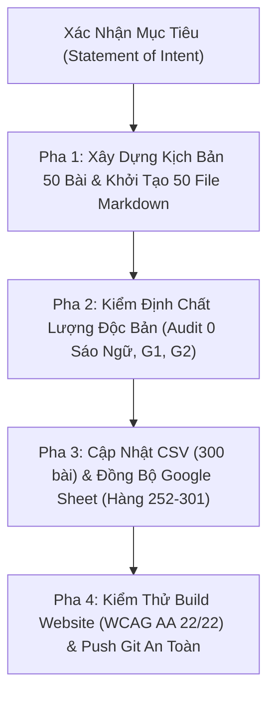

# Kế Hoạch Triển Khai: 50 Bài Nội Dung Chữa Lành, Ánh Sáng & Sức Bật Nội Tâm (STT 251 -> 300)

> **Mục tiêu:** Sản xuất và đồng bộ 50 kịch bản bài đăng mới (STT 251 – 300 / mã `TXT-0251` $\rightarrow$ `TXT-0300`) vào Google Sheet tab `Kế Hoạch 200 Bài (TikTok Pipeline)` (hàng 252 – 301).  
> **Cương lĩnh tư tưởng:** Bước chuyển tông (*Tonal Shift*) từ bóc tách độc hại/bóng tối sang **Tâm lý học Chữa Lành, Tự Trắc Ẩn, Bình Thản Khắc Kỷ & Sức Bật Sau Nghịch Cảnh**.  
> **Tiêu chuẩn chất lượng:** Tuân thủ `HYA-01` (triết lý sâu sắc), `HYA-02` (nguồn học thuật xác thực), `HYA-03` (văn phong nén, không sáo rỗng, không toxic positivity), `HYA-04` (mô hình dữ liệu YAML chuẩn) và `HYA-06` (6 Hard Gates).  
> **Phạm vi hiện tại:** Tập trung 100% vào nội dung chữ (Kịch bản, Slide, Caption bespoke, Hashtags, Metadata). Khâu tạo ảnh sẽ thực hiện ở giai đoạn tiếp theo.

---

## 1. Kiến Trúc 4 Cụm Chủ Đề Trọng Tâm (50 Bài)

| Cụm Chủ Đề | Dải STT | Quy Mô | Tác Giả Học Thuật Cốt Lõi | Thông Điệp Tâm Lý Trọng Tâm |
|---|:---:|:---:|---|---|
| **Cụm 1: Tự Trắc Ẩn & Hòa Giải Với Bản Thân** (*Self-Compassion & Radical Self-Acceptance*) | 251 – 263 | 13 bài | **Kristin Neff**, **Carl Rogers**, **Tara Brach**, **Thích Nhất Hạnh**, **Brené Brown** | Buông bỏ chiếc roi phán xét nội tâm; tha thứ cho phiên bản chưa hoàn hảo trong quá khứ; dũng cảm đón nhận sự mong manh (*vulnerability*); yêu thương đứa trẻ tổn thương bên trong. |
| **Cụm 2: Bình Thản Khắc Kỷ & Làm Chủ Tâm Trí** (*Stoic Serenity & Dichotomy of Control*) | 264 – 275 | 12 bài | **Marcus Aurelius**, **Epictetus**, **Seneca**, **Ryan Holiday** | Phân định rạch ròi giữa điều kiểm soát được và không kiểm soát được; bình thản trước thị phi và phán xét; xây dựng pháo đài tâm trí bất khả xâm phạm; tình yêu định mệnh (*Amor Fati*). |
| **Cụm 3: Kết Nối Lành Mạnh & Giao Tiếp Thấu Cảm** (*Authentic Connection & Compassionate Communication*) | 276 – 288 | 13 bài | **Marshall Rosenberg (NVC)**, **John Gottman**, **Harriet Lerner**, **Erich Fromm** | Nghệ thuật lắng nghe không phán xét; dũng khí cất lời chân thật; thiết lập ranh giới an toàn; cho đi từ chiếc ly đầy; nuôi dưỡng sự gắn kết an toàn (*Secure Attachment*). |
| **Cụm 4: Ý Nghĩa Sống & Sức Bật Sau Nghịch Cảnh** (*Meaning, Flow & Post-Traumatic Growth*) | 289 – 300 | 12 bài | **Viktor Frankl**, **Martin Seligman**, **Mihaly Csikszentmihalyi**, **Abraham Maslow** | Tìm thấy ý nghĩa cuộc đời giữa nghịch cảnh (*Man's Search for Meaning*); sự trưởng thành vượt bậc sau tổn thương; trạng thái dòng chảy (*Flow*); niềm lạc quan có cơ sở; tự hiện thực hóa bản thân. |

---

## 2. Quy Trình Kỹ Thuật 4 Pha (Vertical Slicing)

---

## 3. Danh Mục Nhiệm Vụ Chi Tiết (Task Breakdown)

### Pha 1: Đặc Tả Tri Thức & Khởi Tạo Dữ Liệu Kịch Bản

#### Task 1: Xây dựng Tập dữ liệu Kịch bản 50 bài chuẩn (`scripts/build_50_healing_posts_251_300.py`)
- **Mô tả:** Viết script Python chứa toàn bộ 50 kịch bản chi tiết với 17 trường thông tin chuẩn (STT, Mã ID, Tiêu đề dưới 90 từ, Caption TikTok bespoke 50-80 từ, Tác giả học thuật, Hashtags SEO, Định dạng Slide linh hoạt, Trang 1..4, Chủ đề hạt nhân, Khung giờ vàng, Ý niệm thị giác tranh ánh sáng/ấm áp, Trạng thái).
- **Tiêu chí nghiệm thu:**
  - Đủ 50 bài từ STT 251 đến 300 (mã `TXT-0251` $\rightarrow$ `TXT-0300`).
  - Đa dạng định dạng slide: Single-Punch (đanh thép), Carousel 2 trang (Tension $\rightarrow$ Growth), Carousel 3 trang (Hiện tượng $\rightarrow$ Khơi thông $\rightarrow$ Ánh sáng).
  - 100% Caption bespoke, mở đầu bằng trích dẫn tác giả học thuật và kết thúc bằng câu hỏi tự vấn lay động.
  - Concept tranh tập trung vào trường phái Ấn tượng/Ánh sáng tự nhiên (Monet, Renoir, Corot, Friedrich đón bình minh) thay cho chiaroscuro tăm tối.
- **Xác minh:** `python scripts/build_50_healing_posts_251_300.py` xuất ra `scripts/posts_251_300.json` thành công.
- **Files liên quan:** `scripts/build_50_healing_posts_251_300.py`, `scripts/posts_251_300.json`.
- **Scope:** M (1 script + 1 JSON).

#### Task 2: Sinh 50 Tệp Markdown Lưu Trữ Chuẩn HYA-04 (`TXT-0251.md` đến `TXT-0300.md`)
- **Mô tả:** Tạo 50 file độc lập tại `editorial/content/` với YAML frontmatter chuẩn (`id`, `title`, `content_type`, `author_attribution`, `topic_codes`, `image_ref`, `slide_format`, `status: APPROVED`).
- **Tiêu chí nghiệm thu:**
  - 50 file tồn tại, không lỗi cú pháp YAML.
  - Nội dung bao gồm Tiêu đề, Trích dẫn, Diễn giải & Chiêm nghiệm biên tập, Cấu trúc Slides đa nhịp, Từ khóa & Hashtags.
- **Xác minh:** Kiểm tra số lượng `ls editorial/content/TXT-02[5-9]*.md editorial/content/TXT-0300.md` = 50 files.
- **Files liên quan:** `editorial/content/TXT-0251.md` $\rightarrow$ `TXT-0300.md`.
- **Scope:** L (50 markdown files).

---

### ❖ Checkpoint 1: Kịch Bản & Lưu Trữ Đã Sẵn Sàng
- [ ] File `scripts/posts_251_300.json` tồn tại đủ 50 bài.
- [ ] 50 file Markdown đã tạo thành công trong `editorial/content/`.

---

### Pha 2: Kiểm Định Chất Lượng Biên Tập & Độc Bản Ngữ Nghĩa

#### Task 3: Chạy Bộ Kiểm Định Toàn Diện (`scripts/audit_posts_251_300.py`)
- **Mô tả:** Viết script tự động kiểm tra 50 bài mới:
  - 0 câu mở đầu trùng lặp với 250 bài trước.
  - 0 sáo ngữ AI (loại bỏ hoàn toàn các từ rỗng như "ngọn hải đăng", "cán cân công lý", "bức tranh muôn màu", "hành trình vạn dặm").
  - Kiểm tra độ dài Caption (nằm trong khoảng 45 - 85 từ).
  - Kiểm tra tính xác thực của tác giả (Hard Gate G1).
  - Kiểm tra tính mới ngữ nghĩa và tính tươi sáng/chữa lành (Hard Gate G2).
- **Tiêu chí nghiệm thu:** Audit đạt 100% PASS, không có bất kỳ cảnh báo lỗi trùng lặp hay sáo rỗng.
- **Xác minh:** `python scripts/audit_posts_251_300.py` exit code 0.
- **Files liên quan:** `scripts/audit_posts_251_300.py`.
- **Scope:** S (1 script).

---

### ❖ Checkpoint 2: Vượt Qua Cổng Kiểm Định Chất Lượng
- [ ] 100% không trùng lặp mở đầu bài viết.
- [ ] 100% caption bespoke đạt chuẩn độ dài và văn phong.

---

### Pha 3: Cập Nhật Dữ Liệu & Nạp Google Sheet Pipeline

#### Task 4: Mở rộng Dữ liệu CSV lên 300 Hàng
- **Mô tả:** Cập nhật `scripts/tiktok_200_posts.csv` thành 300 dòng và tạo `scripts/tiktok_300_posts.csv`.
- **Tiêu chí nghiệm thu:** File CSV chứa đúng 301 dòng (1 dòng tiêu đề + 300 dòng nội dung).
- **Xác minh:** `wc -l scripts/tiktok_300_posts.csv` hoặc Python test kiểm tra 301 dòng.
- **Files liên quan:** `scripts/tiktok_200_posts.csv`, `scripts/tiktok_300_posts.csv`.
- **Scope:** S (2 CSV files).

#### Task 5: Nạp Đồng Bộ Hàng Loạt Vào Google Sheet (Hàng 252 – 301)
- **Mô tả:** Sử dụng `gsheets mutate batch` nạp 50 dòng mới vào khoảng `'Kế Hoạch 200 Bài (TikTok Pipeline)'!A252:Q301`. Đồng bộ toàn diện font chữ **Roboto 9pt**, **Text Wrap**, căn lề `Middle` và menu thả xuống cột Trạng Thái (`SẴN SÀNG`).
- **Tiêu chí nghiệm thu:**
  - Hàng 252 là STT 251 (`TXT-0251`).
  - Hàng 301 là STT 300 (`TXT-0300`).
  - Toàn bộ dữ liệu hiển thị xuống dòng thoáng đãng, không tràn dòng, không co dòng.
- **Xác minh:** Chạy `gsheets readonly read` đọc lại các hàng 252, 275, 301 xác nhận dữ liệu đã cập nhật chuẩn xác.
- **Files liên quan:** `scripts/prepare_sheet_batch_251_300.py`, `scripts/sheet_batch_251_300.json`.
- **Scope:** M (1 script + 1 JSON + Google Sheet sync).

---

### ❖ Checkpoint 3: Google Sheet Cập Nhật Hoàn Hảo Đến Bài 300
- [ ] Dữ liệu 50 bài hiển thị đầy đủ trên Google Sheet từ hàng 252 đến 301.
- [ ] Định dạng ô đồng nhất với các bài trước.

---

### Pha 4: Kiểm Thử Toàn Diện Website & Đồng Bộ Git

#### Task 6: Kiểm Thử Build Hệ Thống Thư Viện Tĩnh & WCAG AA
- **Mô tả:** Chạy `npm run build` trong thư mục `website` và chạy bộ test `test/verify-build.js` để đảm bảo 50 file markdown mới không làm gãy schema nội dung.
- **Tiêu chí nghiệm thu:** Build Astro thành công, bộ kiểm định WCAG AA và tính toàn vẹn đạt 22 PASS | 0 FAIL.
- **Xác minh:** `cd website && npm run build && node test/verify-build.js`.
- **Scope:** S (Test verification).

#### Task 7: Đồng Bộ Git Lên Nhánh `feat/the-agora-forum-v2`
- **Mô tả:** Stage toàn bộ các file mới (Markdown, CSV, JSON, Scripts), tạo commit rõ ràng và push lên GitHub.
- **Tiêu chí nghiệm thu:** Working tree sạch sẽ, commit đã được đẩy lên `origin/feat/the-agora-forum-v2`.
- **Xác minh:** `git status` trả về clean.
- **Scope:** S (Git push).

---

### ❖ Checkpoint 4: Hoàn Thành Toàn Bộ Kế Hoạch 50 Bài Mới
- [ ] 50 bài nội dung chữa lành đã nạp thành công vào Google Sheet.
- [ ] Hệ thống mã nguồn và kho lưu trữ Git đã được đồng bộ an toàn.

---

## 4. Quản Trị Rủi Ro (Risks & Mitigations)

| Rủi Ro | Mức Độ | Biện Pháp Kiểm Soát & Khắc Phục |
|---|:---:|---|
| **Bẫy Tích Cực Độc Hại (*Toxic Positivity*)** | Cao | Kiểm soát chặt chẽ bằng nguyên tắc: Luôn công nhận nỗi đau thực tế trước khi đưa ra lối thoát tâm lý; không khuyên "hãy luôn vui vẻ", mà hướng dẫn "ôm ấp sự mong manh và xây dựng sức bật kiên cường". |
| **Lệch Định Dạng Trên Google Sheet (Co dòng, tràn text)** | Trung bình | Kế thừa trực tiếp quy trình `copyPaste` format và `autoResizeDimensions` từ bài 205-250 đã được kiểm chứng, áp dụng ngay khi ghi dữ liệu vào A252:Q301. |
| **Trùng Lặp Ý Niệm Với 250 Bài Cũ** | Trung bình | Sử dụng ma trận tác giả hoàn toàn mới (Kristin Neff, Tara Brach, Marshall Rosenberg, Mihaly Csikszentmihalyi) để mở ra những góc nhìn nhận thức tươi mới. |
