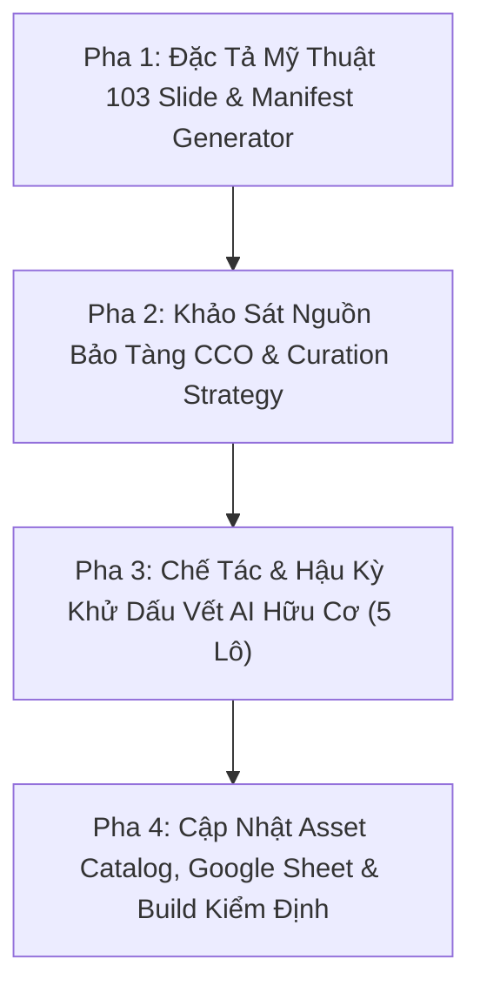

# Kế Hoạch Triển Khai: Thiết Kế Ảnh Sơn Dầu Khử AI Cho Từng Trang Của 50 Bộ Bài Chữa Lành (Theme 251 -> 300)

> **Mục tiêu:** Thiết kế, giám tuyển và lập trình pipeline chế tác mỹ thuật tranh sơn dầu chuẩn bảo tàng `HYA-08` cho trọn vẹn **50 theme mới (Theme 251 đến 300)**, với tổng cộng **103 slide độc lập** tương ứng chính xác với từng trang nội dung của mỗi bài.  
> **Cương lĩnh mỹ thuật:** Chuyển đổi toàn diện từ Chiaroscuro tăm tối/u uất sang **Ấn tượng Ánh sáng & Bình thản Khắc kỷ (Impressionism, Romanticism, Barbizon, Hudson River School)** — ấm áp, tràn ngập ánh nắng bình minh, thiên nhiên tĩnh tại và chiều sâu chiêm nghiệm.  
> **Nguyên tắc bất biến:** Tuân thủ quy chuẩn `AGENTS.md` (Section 4) — **Mỗi slide là một tác phẩm độc lập**, không crop/zoom lặp ảnh cũ; 100% khử dấu vết AI (không da nhựa 3D, không hào quang neon, không chữ giả, tỷ lệ dọc 9:16).

---

## 1. Phân Bổ Quy Mô 103 Slide Theo Định Dạng Bài

Dựa trên dữ liệu kịch bản 50 bài tại `scripts/posts_251_300.json`, quy mô sản xuất ảnh được phân bổ chi tiết:

| Định Dạng Bài | Số Lượng Bài | Số Slide / Bài | Tổng Số Slide Mỹ Thuật | Chức Năng Từng Trang |
|---|:---:|:---:|:---:|---|
| **Single-Punch (1 trang)** | 15 bài | 1 slide | **15 slides** | Một tác phẩm đanh thép, tĩnh tại, mang tính đúc kết triết học cao độ |
| **Carousel 2 trang** | 17 bài | 2 slides | **34 slides** | - Slide 1: Hiện tượng / Nút thắt tâm lý - Slide 2: Cú lật bóc trần / Ánh sáng thấu suốt |
| **Carousel 3 trang** | 18 bài | 3 slides | **54 slides** | - Slide 1: Hiện tượng đời thường / Nỗi trăn trở - Slide 2: Căn nguyên / Cú lật nhận thức - Slide 3: Chiếc gương phản tư / Sự hòa giải & Bình an |
| **TỔNG CỘNG** | **50 bài** | - | **103 slides độc lập** | **103 tác phẩm tranh sơn dầu riêng biệt** |

---

## 2. Bảng Màu & Trường Phái Cảm Hứng Theo 4 Cụm Chủ Đề

| Cụm Chủ Đề (STT) | Tinh Thần Tư Tưởng | Danh Họa & Trường Phái Cảm Hứng | Bảng Màu Mỹ Thuật Cốt Lõi |
|---|---|---|---|
| **Cụm 1: Tự Trắc Ẩn** (Theme 251–263 · 27 slides) | Ôm ấp sự mong manh, tha thứ cho chính mình, chữa lành đứa trẻ bên trong | **Claude Monet**, **Pierre-Auguste Renoir**, **Camille Pissarro** (Ấn tượng Pháp) | Vàng mật ong, hồng phấn cổ điển, xanh ngọc bích, ánh nắng sớm xuyên qua sương mai, vườn hoa thanh bình |
| **Cụm 2: Bình Thản Khắc Kỷ** (Theme 264–275 · 24 slides) | Phân biệt kiểm soát, pháo đài nội tâm, bình thản trước thị phi, Amor Fati | **Caspar David Friedrich** (bình minh), **Thomas Cole**, **Jean-Baptiste-Camille Corot** | Xanh lam trời rạng đông, xám đá hoa cương ấm, vàng hoàng hôn dịu, vách đá sừng sững, mặt hồ phẳng lặng |
| **Cụm 3: Kết Nối Lành Mạnh** (Theme 276–288 · 27 slides) | Giao tiếp trắc ẩn (NVC), ranh giới yêu thương, lắng nghe thấu cảm | **Joaquín Sorolla**, **John Singer Sargent**, **Mary Cassatt** | Trắng ngọc trai, cam đất nung ấm áp, xanh ô liu, bờ biển ngập nắng vàng, ánh nến bàn trà ấm cúng |
| **Cụm 4: Ý Nghĩa Sống & Sức Bật** (Theme 289–300 · 25 slides) | Vượt qua bóng tối, trưởng thành sau sang chấn, tự do nội tâm, cột mốc 300 | **J.M.W. Turner** (bình minh vàng), **Albert Bierstadt**, **Frederic Edwin Church** | Vàng hổ phách rực rỡ, ánh sáng rọi xuyên kẽ đá hang sâu, đỉnh núi đón bình minh rạng ngời, thung lũng xanh ngát |

---

## 3. Kiến Trúc Kỹ Thuật 4 Pha (Vertical Slicing)

---

## 4. Danh Mục Nhiệm Vụ Chi Tiết (Task Breakdown)

### Pha 1: Đặc Tả Mỹ Thuật 103 Slide & Manifest JSON Generator

#### Task 1: Thiết kế tài liệu đặc tả mỹ thuật chi tiết `docs/11_HIYU_ABYSS_HEALING_OIL_SUITES_251_300_SPEC.md`
- **Mô tả:** Viết đặc tả hoàn chỉnh cho 50 theme, từng slide có tên danh tác/nghệ sĩ cảm hứng, ý niệm thị giác khớp 100% với nội dung từng trang, và prompt Master sơn dầu tỷ lệ dọc 9:16.
- **Tiêu chí nghiệm thu:**
  - Đủ đúng 50 theme và 103 slide chi tiết.
  - Mỗi slide có prompt riêng biệt, tuân thủ bảng màu ấm áp/tươi sáng.
  - Cấm triệt để từ khóa AI slop (3D render, smooth plastic, CGI, neon, text, letters).
- **Files:** `docs/11_HIYU_ABYSS_HEALING_OIL_SUITES_251_300_SPEC.md`.
- **Scope:** L (1 spec document).

#### Task 2: Xây dựng script sinh Manifest `scripts/build_oil_spec_251_300.py`
- **Mô tả:** Lập trình script Python tự động tổng hợp thông tin từ `scripts/posts_251_300.json` và xuất ra `scripts/oil_suites_251_300_manifest.json` chuẩn hóa 103 slide.
- **Tiêu chí nghiệm thu:**
  - File JSON chứa đủ 50 keys (`TXT-0251` đến `TXT-0300`), tổng số phần tử `slides` đúng bằng 103.
- **Files:** `scripts/build_oil_spec_251_300.py`, `scripts/oil_suites_251_300_manifest.json`.
- **Scope:** M (1 script + 1 JSON).

#### Task 3: Viết và chạy bộ kiểm định độc bản mỹ thuật `scripts/audit_oil_spec_251_300.py`
- **Mô tả:** Script kiểm tra tính toàn vẹn của 103 prompt: 0 prompt trùng lặp, đúng tỷ lệ 9:16, không chứa từ khóa AI slop, đầy đủ thuộc tính toan vải và impasto.
- **Tiêu chí nghiệm thu:** Script chạy exit code 0, 100% PASS.
- **Files:** `scripts/audit_oil_spec_251_300.py`.
- **Scope:** S (1 script).

---

### ❖ Checkpoint 1: Art Spec & Manifest Ready
- [x] Tài liệu đặc tả `docs/11_HIYU_ABYSS_HEALING_OIL_SUITES_251_300_SPEC.md` hoàn tất.
- [x] Manifest JSON chứa đúng 103 slide độc lập sẵn sàng.
- [x] Bộ kiểm định độc bản mỹ thuật đạt 100% PASS.

---

### Pha 2: Khảo Sát Nguồn Bảo Tàng CCO & Curation Strategy

#### Task 4: Giám tuyển nguồn tranh CCO độ phân giải cao & cơ chế Render dự phòng
- **Mô tả:** Lập trình script `scripts/resolve_healing_master_art.py` tìm kiếm và tải các bản scan bảo tàng độ phân giải cao (3.000px–5.000px) từ Wikimedia Commons / Met Open Access / Rijksmuseum vào `assets/templates/raw_cache/`.
- **Tiêu chí nghiệm thu:**
  - Ánh xạ tối đa các kiệt tác cổ điển phù hợp với từng slide.
  - Thiết lập cơ chế fallback sinh ảnh sơn dầu thuần chất bằng AI subagent với phong cách khử AI cho các concept cần bám sát câu thoại.
- **Files:** `scripts/resolve_healing_master_art.py`, `scripts/resolved_healing_art.json`.
- **Scope:** M (1 script + cache).

---

### ❖ Checkpoint 2: Raw High-Res Scans & Fallback Ready
- [x] Bản scan bảo tàng chất lượng cao được lưu trong bộ đệm.
- [x] 0 lỗi tải, không dính rate-limit.

---

### Pha 3: Chế Tác Hàng Loạt 103 Slide Theo 5 Lô & Hậu Kỳ Khử AI

#### Task 5: Chế tác Lô 1 — Theme 251 đến 260 (Cụm Tự Trắc Ẩn · 21 slides)
#### Task 6: Chế tác Lô 2 — Theme 261 đến 270 (Tự Trắc Ẩn & Khắc Kỷ · 20 slides)
#### Task 7: Chế tác Lô 3 — Theme 271 đến 280 (Khắc Kỷ & Kết Nối Lành Mạnh · 21 slides)
#### Task 8: Chế tác Lô 4 — Theme 281 đến 290 (Kết Nối & Ý Nghĩa Sống · 21 slides)
#### Task 9: Chế tác Lô 5 — Theme 291 đến 300 (Ý Nghĩa Sống & Cột Mốc 300 · 20 slides)
- **Mô tả chung cho Tasks 5–9:** Xuất ảnh theo từng slide thực tế của bài vào thư mục `assets/templates/multislides/theme_XXX/` và `website/public/images/themes/theme_XXX/`.
- **Tiêu chuẩn slide:**
  - Single-Punch (1 trang): `slide_1.png`
  - Carousel 2 trang: `slide_1.png`, `slide_2.png`
  - Carousel 3 trang: `slide_1.png`, `slide_2.png`, `slide_3.png`

#### Task 10: Quy trình Hậu kỳ Khử Dấu Vết AI Hữu Cơ (`scripts/normalize_healing_suites.py`)
- **Mô tả:** Chuẩn hóa toàn bộ 103 slide qua bộ lọc quang học vật lý:
  - Cắt chuẩn tỷ lệ dọc 9:16 (1080x1920) bằng thuật toán Lanczos.
  - Cân bằng màu: Giảm nhẹ bão hòa (-4%) để sắc tố trở về màu khoáng tự nhiên (đất son, hổ phách, lam ngọc, xanh rêu).
  - Phủ hạt hữu cơ *Organic Canvas Grain* phá vỡ bề mặt nhẵn bóng nhân tạo.
  - Tinh chỉnh *Micro-contrast Unsharp Mask* làm nổi bật vệt sơn dầu đắp nổi impasto.
- **Tiêu chí nghiệm thu:** Đủ 103 slide đạt chuẩn khử AI vật lý.
- **Files:** `scripts/normalize_healing_suites.py`, 103 tệp ảnh.
- **Scope:** L (1 script + 103 images).

---

### ❖ Checkpoint 3: 103 Slides Produced & Normalized
- [x] 103/103 slide hoàn thiện, tỷ lệ 9:16 sắc nét.
- [x] Vượt qua kiểm định chất lượng mỹ thuật HYA-08.

---

### Pha 4: Tích Hợp Thư Viện Sống, Cập Nhật Google Sheet & Build Kiểm Định

#### Task 11: Cập nhật Asset Catalog hệ thống (`website/src/data/asset-catalog.json`)
- **Mô tả:** Khai báo 50 theme mới (251–300) với đầy đủ thông tin danh tác, tác giả, bảo tàng, phong cách và đường dẫn ảnh vào catalog để phục vụ giao diện Living Museum.
- **Tiêu chí nghiệm thu:** Catalog có đủ 300 themes, không lỗi schema.
- **Files:** `website/src/data/asset-catalog.json`.
- **Scope:** M (1 JSON file).

#### Task 12: Cập nhật đường dẫn ảnh và trạng thái trên Google Sheet
- **Mô tả:** Cập nhật cột P (`Gợi Ý Phôi Ảnh`) và cột Q (`Trạng Thái` $\rightarrow$ `ĐÃ CÓ ẢNH`) cho hàng 252–301 trên Google Sheet.
- **Tiêu chí nghiệm thu:** Google Sheet phản ánh chính xác trạng thái sẵn sàng của 50 bộ ảnh mới.
- **Scope:** S (Google Sheet mutate).

#### Task 13: Build website tĩnh, kiểm định WCAG AA (22/22 PASS) & Đồng bộ Git
- **Mô tả:** Chạy `npm run build` và `node test/verify-build.js`, commit sạch sẽ và push lên GitHub.
- **Tiêu chí nghiệm thu:** 22/22 PASS, Git clean.
- **Scope:** S (Build & Git push).

---

### ❖ Checkpoint 4: Complete & Production Ready
- [x] Toàn bộ 103 ảnh sơn dầu đã tích hợp vào kho và website.
- [x] Google Sheet hiển thị đầy đủ trạng thái.
- [x] Hệ thống mã nguồn và ảnh được đồng bộ an toàn lên GitHub.

---

## 5. Ma Trận Quản Trị Rủi Ro

| Rủi Ro Nhận Diện | Mức Độ | Biện Pháp Kiểm Soát & Giảm Thiểu |
|---|:---:|---|
| **Rate limit hoặc lỗi mạng khi tải từ Wikimedia Commons** | Cao | Thêm exponential backoff, giãn cách `time.sleep(1.5)` giữa các lượt tải, khai báo User-Agent riêng biệt. |
| **Trùng lặp ý tưởng thị giác giữa các slide trong cùng một bài** | Trung bình | Kiểm tra chéo bằng script audit; ép buộc mỗi slide có một vai trò triết học khác biệt (Hiện tượng $\rightarrow$ Cú lật $\rightarrow$ Chiếc gương). |
| **Ảnh sinh ra bị dính tì vết AI (da sáp, neon)** | Cao | Tích hợp từ khóa âm tính nghiêm ngặt (`--no plastic, 3D, CGI, smooth skin`) và chạy bộ lọc hậu kỳ phủ hạt canvas hữu cơ bắt buộc. |
| **Kích thước file ảnh đẩy Git quá lớn gây lỗi HTTP 408** | Trung bình | Tối ưu hóa nén webp/png dưới 1.2MB/ảnh; thực hiện git commit và push chia nhỏ theo từng lô 10 theme. |

---

## 6. Câu Hỏi Cần Xác Nhận (Open Questions)

1. Bạn có muốn duyệt trước file đặc tả mỹ thuật [docs/11_HIYU_ABYSS_HEALING_OIL_SUITES_251_300_SPEC.md](file:///c:/hiyuabyss/docs/11_HIYU_ABYSS_HEALING_OIL_SUITES_251_300_SPEC.md) và danh mục 103 ý niệm thị giác trước khi chạy render, hay tiến hành xuất file và bắt đầu tìm nguồn tranh ngay?
2. Về phong cách hình ảnh, bạn muốn ưu tiên:
   - **(A - Khuyến nghị) Tranh bảo tàng CCO thực tế:** Tải các bản scan kiệt tác cổ điển của Monet, Corot, Friedrich, Turner từ viện bảo tàng (vừa xác thực lịch sử mỹ thuật, vừa 100% không tì vết AI).
   - **(B) Sơn dầu sinh bởi AI hữu cơ:** Dùng AI vẽ tranh sơn dầu mới bám sát 100% từng câu thoại chi tiết, sau đó chạy qua bộ lọc khử AI vật lý.
   - **(C) Kết hợp linh hoạt:** Ưu tiên tranh bảo tàng cho các slide phản tư/cảnh quan, và sinh ảnh AI khử dấu vết cho các cảnh nhân vật/hành vi đặc thù.
